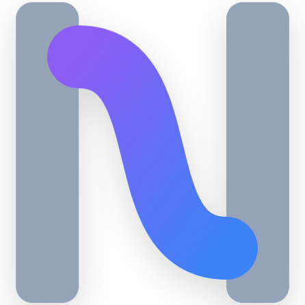

<div align="center">
  
  <h1>Nexa</h1>
  <p>An agent-native language and reliable runtime for humans and models authoring .nx programs.</p>
</div>

[中文](README.md) | **English** · Python 3.10+ · AGPL-3.0-or-later

Nexa 3.0 **Open Programs** gives a program persistent goals, implementations, evidence and revisions. Humans and models author the same typed `.nx` contract. The compiler can clarify a goal, propose an implementation and evaluate it; the runtime admits a revision when its current evidence and authority satisfy the policy.

## What changes in 3.0

- **Compilation includes resolution.** An `implementation open` goal carries types, capabilities and acceptance requirements. The compiler proposes candidates within a budget and checks them in OCI.
- **Completion has conditions.** Deterministic checks, model reviews and human decisions remain separate records. Changed inputs or dependencies trigger revalidation; newer failures prevent old successes from authorizing work.
- **Programs retain revisions.** Activities stay pinned to immutable versions. Checkpoints admit new revisions, and unknown external effects require reconciliation.
- **Workspace changes need exact grants.** A maintenance task produces a reviewable patch. Grants bind the patch, baseline, scope and evidence; a journal and retained originals support concurrent edits and recovery.
- **Reuse carries its conditions.** Local implementation capsules include provenance, license, dependencies and evidence. Receiving tasks validate compatibility and current results.
- **The compiler participates in evolution.** The author JSON-RPC protocol supports clarification, diagnostics and cancellation. A diagnostic advice pass can be selected after frozen tests, C1/C2 locked bootstrap and approval.

[Release notes](docs/release_notes/v3.0.0.md) · [Usage](docs/spec/3.0/usage.md) · [Core contract](docs/spec/3.0/core.md) · [Author protocol](docs/spec/3.0/author-protocol.md) · [Migration](docs/migration/2.4-to-3.0.md)

## Getting started

Use Python 3.10+. The 3.0 runtime supports Linux/macOS and requires Docker Engine or Docker Desktop / Colima for candidate execution. In an activated virtual environment, install the [3.0.0 wheel](https://github.com/Nexa-Language/Nexa/releases/tag/v3.0.0):

```sh
python -m pip install https://github.com/Nexa-Language/Nexa/releases/download/v3.0.0/nexa_lang-3.0.0-py3-none-any.whl
nexa --version
```

The `nexa-lang` PyPI name belongs to another project; use the full artifact URL. Save this as `answer.nx`:

```nexa
language "3.0"
program Answer {
    goal answer() -> Int {
        intent "Return 42"
        implementation value 42
    }
}
```

`nexa check answer.nx --json` checks the contract offline, without Docker or credentials. Follow the [usage guide](docs/spec/3.0/usage.md) to build, execute and replay a lock. Open implementations additionally require a provider and suitable acceptance checks.

For the source and examples:

```sh
git clone --branch v3.0.0 --depth 1 https://github.com/Nexa-Language/Nexa.git
cd Nexa
uv sync --locked --all-extras
uv run nexa check examples/open_programs/sum.nx --json
```

The [Aliyun configuration](examples/open_programs/aliyun.json) binds environment variable names and the tested `qwen3.8-max-0902` model. Candidate containers have no host mounts, credentials or external network. Start repository maintenance with [maintain.nx](examples/open_programs/maintain.nx) and the corresponding frozen checks.

## Existing 2.4 programs

Sources without `language "3.0"` retain the 2.4 frontend. Agents, tools, Protocol and flows remain available, as do the public `src.*` imports. Configure these entry points using the [development guide](docs/development.md#configure-your-first-model).

### Retained runtime capabilities

- One compiler boundary for CLI, SDK, and embedded API: recursive includes, normalized AST, Harness diagnostics, and Python syntax validation. Distributions include the `.nx` standard library.
- One AgentRunner for text, Protocol, streaming, and exact-cache results. `execute()` creates an isolated RunState; `run()` retains a serialized conversation.
- Native Chat Completions, Responses, and Anthropic adapters preserve tool calls, usage, and opaque reasoning or signed thinking state.
- Tool exposure, JSON Schema validation, explicit approvals, and truthful isolation status share one dispatch boundary.
- Versioned SQLite checkpoints use optimistic concurrency and a tool journal. Completed tool results are reused; uncertain side effects require operator reconciliation.
- `continue_run()` starts a new turn from settled history, retaining native provider state with fresh budgets, deadlines and approvals, linked by parent and session identifiers.
- Bounded parallel execution, cancellation signals, deadlines, call and token budgets, and bounded tool-output artifacts.
- IAL checks distinguish pass, fail, skip, and error. Failed `verify` statements stop the success path.
- Official MCP SDK connections, shared Python/Rust fixtures, and real Wasmtime 48 LTS execution with resource limits.

See the [2.4.0 release notes](docs/release_notes/v2.4.0.md) for artifacts and verification scope, and the [runtime contract and migration guide](docs/runtime-v2.4.md) for detailed behavior.

## Durable agent execution

```sh
uv run nexa agent examples/Nexa-Code/main.nx CodeAssistant "Fix the failing test" --timeout 900
# Inspect pending_calls, then approve the specific call:
uv run nexa agent examples/Nexa-Code/main.nx CodeAssistant --resume RUN_ID --approve CALL_ID
```

Use `--deny CALL_ID` to reject a tool call and `--checkpoint PATH` to select a database. The default is `.nexa/runs.sqlite3`. Exit codes are 0 for completion, 2 for approval, and 1 for other stopped states. Source, provider, workspace and budgets must match when resuming. Deadlines include approval waiting time.

```python
from src.runtime.agent import NexaAgent
from src.runtime.checkpoints import SQLiteCheckpointStore
from src.runtime.run_state import RunConfig

agent = NexaAgent("Analyst", prompt="Explain the evidence")
store = SQLiteCheckpointStore(".nexa/runs.sqlite3")
state = agent.execute("Analyze this result", config=RunConfig(timeout=120), save=store.save)
print(state.status, state.output)
```

The existing `src.nexa_sdk.compile()` / `run()` and public `src.*` import paths remain available. Provider API selection accepts `chat`, `responses`, and `anthropic`; native Anthropic uses `ANTHROPIC_API_KEY` and optional `ANTHROPIC_BASE_URL`.

## Development and verification

```sh
uv run pytest -m "not benchmark"
uv build --no-build-isolation
cargo test --manifest-path avm/Cargo.toml --locked --lib --test conformance --test wasm_execution
cargo test --manifest-path avm/Cargo.toml --locked --features wasm --lib --test conformance --test wasm_execution
```

Open Programs implementations execute in OCI; workspace application requires a separate grant. Python is the reference runtime. Rust retains its explicit 2.4 subset, returning errors for unsupported instructions. Legacy Python tools execute on the host; requesting a sandbox without an isolated executor fails. WASM execution requires the `wasm` feature. Cancellation of arbitrary Python handlers is cooperative. Context limits use a conservative UTF-8 byte bound; native provider history is retained and oversized requests fail explicitly.

Offline provider fixtures verify runtime behavior. The [360-stage synthetic evaluation](plan/evidence/2026-10-23-open-programs-experiment.md) records real Aliyun results: Open Programs accepted 73/90 stages and the adapted 2.4 baseline 70/90. Token totals, failures and methodology corrections are reported separately. [Nexa Code](examples/Nexa-Code/README.md) and the versioned [evaluation tasks](evals/tasks) exercise actual file edits and subprocess verification in temporary workspaces.

The [example manifest](examples/manifest.json) records 67 compilation or contract-check cases and 12 historical drafts with explicit failure reasons. `uv run pytest tests/test_examples.py -q` checks every supported file. Execution of examples with model, database or server dependencies requires the corresponding environment.

- [Development guide](docs/development.md)
- [Runtime contract](docs/runtime-v2.4.md)
- [Syntax reference](docs/01_nexa_syntax_reference.md)
- [Compiler architecture](docs/02_compiler_architecture.md)
- [3.0 implementation and validation](plan/04-v1-open-programs-execution.md)
- [License](LICENSE)
