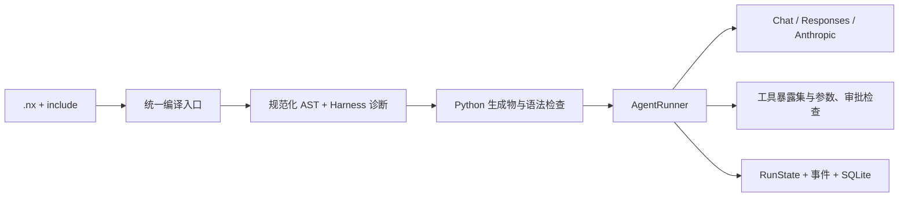

# Nexa 2.4 运行契约与迁移

Nexa 保留 Agent 原生语言的核心：人在 `.nx` 中定义目标、工具、约束和控制流，模型可以生成同一种程序；运行时负责执行这些声明并给出可核验的结果。Python 编译器与运行时是参考实现，Rust AVM 通过共同语义用例逐步扩展。

## 编译与运行



`src.compiler.compile_file` 与 `compile_source` 统一 CLI、SDK、嵌入式 API 的编译行为，inspect/validate 使用同一个模块加载器。include 相对导入文件解析，再查包内标准库；同一规范路径导入一次，循环依赖报告路径链。Harness 节点诊断包含原文件、行和列，嵌套节点与被 include 的文件保留自己的位置。声明模块可以单独编译。Python 生成物在返回成功前接受语法检查。

`NexaAgent.run()` 保留连续会话与直接返回值；同一实例的调用串行化。`execute()` 创建独立会话，返回 `RunState`；`aexecute()` 提供异步适配。并行编排使用独立会话，默认最多同时执行 8 个任务，输出按输入顺序排列。

`inspect --format json` 的声明条目包含 `source: {file, line, column, end_line, end_column}`。行列从 1 开始，结束位置为开区间；被 include 的声明保留自己的原文件位置。解析失败时的正则提取不提供 source，编辑器应显示解析错误而不猜测导航位置。

## 语言执行范围

示例清单的 `compiled` 表示编译和生成 Python 语法检查通过。2.4 的以下历史语法仍有执行缺口：struct 构造生成的名称未定义；带参数 enum variant 构造的字段传递错误；flow 的 `requires`/`ensures` 与 ContractClause 接口不一致；`defer` 未完成运行时降级。这些路径暂不适合实际程序，复现源码与结果见 [离线语言探测](../plan/evidence/2026-10-23-language-probes.json)。

以控制流语句结束的 flow 返回 `None`；需要返回计算值时，在末尾添加顶层 `result = value;`。当前 `std.json.parse` 返回 JSON 文本，消费集合前通过可信 Python 显式解码。Agent 的 Protocol 输出校验与 Harness `verify` 使用独立执行路径，覆盖范围见测试与发布验证记录。

顺序管道 `input >> AgentA >> AgentB` 按顺序执行全部阶段。下游阶段必须是 Agent 引用；不支持的表达式在编译时报告错误。历史 `input >> Reviewer ?? { ... }` 块式条件路由尚未实现 cases 分派，2.4 明确拒绝该管道阶段。

## 模型协议

```nexa
agent Analyst {
    prompt: "Analyze the supplied evidence."
    provider_api: "responses"
    timeout: 120
    max_tool_calls: 8
}
```

`provider_api` 支持 `chat`、`responses`、`anthropic`。默认采用 Chat Completions；`anthropic/model-name` 默认采用原生 Anthropic API。模型名从现有配置读取，也可在声明中指定。

Responses 保存原始 output items 和 encrypted reasoning；Anthropic 保存原始 content blocks，包括 thinking 签名。工具结果通过各自原生消息格式回传。流式、普通文本、Protocol 和缓存命中共用输出校验及完成处理。截断、拒绝和未收到完成事件的流返回失败。

精确响应缓存仅用于无工具的 Chat 新运行。缓存键包含有效上下文、系统指令、模型、provider endpoint 和输出契约；命中前仍检查上下文限制。Responses 和 Anthropic 的会话状态随真实请求保存，当前不缓存它们的响应。

Chat / Responses 继续使用 `.nxs` 与现有 provider 配置。原生 Anthropic 使用 `ANTHROPIC_API_KEY` 和可选的 `ANTHROPIC_BASE_URL`；安装 `anthropic` extra。凭据在首次实际调用时读取，离线编译无需凭据。

`.nxs` 按父目录到当前目录合并，同名配置由最近目录覆盖。脚本目录加载遵循同一优先级；项目配置因此覆盖父目录默认值。

Agent 属性 `max_tokens` 和 `@limit(max_tokens=...)` 设置单次模型响应的输出 token 上限；总运行预算通过 `RunConfig.max_tokens` 设置。`max_history_turns` 支持整数及历史数字字符串写法。`@timeout(seconds=...)` 设置运行时限；`@retry(max_attempts=...)` 设置包含首次调用的总尝试次数，运行时转换为 `max(0, max_attempts - 1)` 次重试，0/1 均不重试。装饰器优先于同名属性。`@temperature` 当前仅保留声明元数据，尚未传给 provider。

## 预算、取消与输出

```python
from src.runtime.agent import NexaAgent
from src.runtime.run_state import RunConfig

agent = NexaAgent("Analyst", prompt="Analyze evidence")
state = agent.execute("Explain the findings", config=RunConfig(
    timeout=120,
    max_model_calls=8,
    max_tool_calls=4,
    max_tokens=12000,
))
print(state.status, state.output, state.error)
```

状态为 `running`、`waiting_approval`、`completed`、`failed`、`cancelled`、`timed_out` 或 `budget_exhausted`。每次模型请求，包括重试，计入调用预算；工具预算按实际单个调用计数。Token 预算依据 provider 返回的 usage 累计，缺少 usage 时明确失败；一次请求的输入成本只能在 provider 返回后确认，累计超预算后停止后续调用。

总超时包含审批等待和恢复前的墙钟时间。请求使用剩余时间作为超时。取消在模型、流式输出与工具边界协作检查；正在运行的任意 Python 工具需要自行提供可取消行为。

工具输出超过 `max_tool_output_chars` 时存入 `.nexa/artifacts`，模型收到摘要、内容哈希和读取工具名。`__nexa_read_artifact` 按字符偏移读取有限片段。checkpoint、trace 和 artifact 可能包含任务数据，应按项目数据策略保管；默认目录已加入 Git ignore。

## 工具与审批

```nexa
@tool("Write a reviewed report", requires_approval: true, risk_level: "high")
fn write_report(content: string): string {
    python! """
from src.runtime.workspace_tools import write_file
return write_file("report.md", content)
"""
}

agent Writer uses write_report { prompt: "Prepare the report." }
```

运行时只执行声明暴露的工具，并验证 JSON Schema、参数类型和额外字段。高风险或 `requires_approval` 工具暂停等待明确的布尔审批。`sandbox: true` 在缺少隔离执行器时返回错误；普通 Python 工具的执行记录为 `sandboxed=false`。

运行一个 `.nx` Agent 并保存 checkpoint：

```sh
uv run nexa agent examples/Nexa-Code/main.nx CodeAssistant "Read and fix the failing test" --timeout 900
# 输出 waiting_approval 后，核对 pending_calls 中的参数，再执行：
uv run nexa agent examples/Nexa-Code/main.nx CodeAssistant --resume RUN_ID --approve CALL_ID
# 拒绝某次调用：
uv run nexa agent examples/Nexa-Code/main.nx CodeAssistant --resume RUN_ID --deny CALL_ID
```

`--checkpoint` 可指定 SQLite 文件。程序源码、Agent 定义、provider、预算和工作目录在恢复时检查一致性；启动恢复命令时应回到原工作区。CLI 返回码：完成为 0，等待审批为 2，其他停止状态为 1。

## 恢复保证

```python
from src.runtime.checkpoints import SQLiteCheckpointStore

store = SQLiteCheckpointStore(".nexa/runs.sqlite3")
state = agent.execute("Task", save=store.save)
# 在另一个进程重新建立相同 Agent 定义后：
state = agent.execute(state=store.load(state.run_id), save=store.save)
```

SQLite 以事务和 revision 检测并发写入。工具调用前写入 `started`，调用完成后先保存结果，再附加消息。已保存的工具结果在恢复时复用。若只有 `started` 记录，运行停止并报告未知结果；操作者核实实际副作用后，用 `store.resolve_tool(...)` 写入真实结果再恢复。这个设计保留副作用不确定的事实，外部系统可用幂等键进一步收紧保证。

网络超时、连接中断、响应流读取/解码失败、shell 超时和 MCP 断连遵循相同规则。标准库包装层向上传播这类异常，journal 保持 `started`，模型不会收到可继续重试的普通成功结果。自定义工具在结果不确定时应抛出 `ToolOutcomeUnknown`；工具自行吞掉异常后，运行时只能看到它返回的值。

### 新一轮对话

```python
next_state = agent.continue_run(
    state, "Continue with the findings", save=store.save,
    config=RunConfig(timeout=120, max_model_calls=8, max_tool_calls=4),
)
```

`execute(state=...)` 恢复同一次运行；`continue_run(previous, *args, ...)` 从已结束的运行开启新一轮。后者生成新 `run_id`、期限、计数器、事件、审批和 journal，通过 `metadata.parent_run_id` 与 `metadata.session_id` 关联历史。省略 config 时沿用预算值，期限重新计时；前一轮的 RunState 保持原样。回调与 provider 参数和 execute 相同。

`completed`、`cancelled`、`timed_out`、`budget_exhausted` 和工具结果已确定的 `failed` 可续接。`running`、`waiting_approval` 先恢复或取消。已有工具结果保留，已确认未执行的 pending call 补充取消结果；存在 `started` 等未知结果的 journal 时拒绝续接，先核实并解决副作用。Chat 消息与原生 Responses/Anthropic items/cursor 一起保留，损坏的工具配对会报错。工作目录、Agent、模型、provider 和定义保持一致；切换这些身份信息时创建新会话。

新的预算可以调整，artifact 目录沿用原值，以便读取历史输出。provider 返回重复的历史 tool-call ID 时，在执行工具前失败，避免旧结果与新调用错误配对。

## Harness 语义

| 声明 | 运行行为 |
|---|---|
| `autoloop` | 执行步数与时间上限；`exit_when` 与最后一次赋值的文本或 `status` 字段精确比较，忽略首尾空白及大小写 |
| `with_context` | 异常时也退出作用域；Chat 按完整 user turn 裁剪，保持工具调用与结果配对 |
| `snapshot` / `restore` | 深拷贝恢复 flow 变量、Agent 会话、工具结果和 provider 状态；外部文件与服务副作用保留 |
| `fork ... merge all/first/vote` | 有界执行、独立 Agent 会话、稳定顺序；`best` / `best_of` 要求结果提供数值 `score` |
| `verify` | 失败抛出断言错误，阻止后续成功路径 |
| `reflect` | 将反思内容注入后续 Agent 输入 |
| 生命周期 hook | 绑定当前 flow 的模型和工具事件，flow 结束后清理 |
| `spawn` / `pass` / `await` | flow 拥有 Actor 生命周期；每个 Actor 有独立会话和顺序邮箱，最多 8 个活跃 Actor；`await` 关闭邮箱并取得最后结果 |

上下文限制目前按序列化 UTF-8 字节数作保守 token 上界，实际 usage 单独记录。单个最新回合超过上限时失败。原生 provider 需保留 opaque items，超出上下文或历史上限时要求缩短输入，避免丢失协议状态。`ContextSpec` 的 `shared:name` 在 flow 内共享深拷贝快照，`discard` 不产生下游 context；schema 名称按名义相等检查。

Actor 的后续消息沿用该 Actor 的会话，并累计模型/工具调用预算与总时限。所有 Actor 必须在 flow 返回前 `await`；异常或漏掉 await 时取消其余任务并等待线程退出，再报告失败。模型 Actor 自动消费邮箱；独立 `receive()` 需要自定义消息处理器，当前会明确报错。Actor 会话限于当前 flow；需要跨进程审批和恢复的任务使用 `execute()` 或 `nexa agent`。

迁移时检查旧的 `exit_when` 文本：原先的自由文本包含判断已改为精确状态比较。`verify`、结构化输出校验、sandbox 和审批约束都参与实际执行；原先靠忽略这些声明继续运行的程序需要提供有效条件、符合 schema 的输出或审批结果。

`.nxintent` 检查使用 `pass/fail/skip/error`。缺少 runtime、schema 或语义评判器时明确 skip；空输出验证失败；评判器异常为 error。只有 pass 计为通过。确定性的 `verify` 谓词支持类型、数值比较、包含关系和长度检查，其他语义需要显式 evaluator。

## MCP

安装 `uv sync --extra mcp`。MCP 使用官方 Python SDK 2.3，支持 stdio 和 SDK 支持的 HTTP URL，协议发现、分页和关闭由 SDK 会话处理。

```python
from mcp import StdioServerParameters
from src.runtime.mcp_client import MCPClient

with MCPClient(target=StdioServerParameters(command="python", args=["server.py"])) as client:
    agent = NexaAgent("Researcher", tools=client.get_tools_schema())
    state = agent.execute("Inspect the available information")
```

发现的远程工具默认需要审批，服务端注解不会授予执行权限。`fetch_mcp_tools()` 兼容单个 `mcpServers` 配置文件；旧 `tools` JSON 文件保留 schema 读取并提示弃用。SDK/API 会在程序执行结束时关闭其会话。

## Rust 能力子集

Rust 当前贯通声明初始化、整数/浮点算术、局部及全局变量、跳转、返回和 Agent 调用；`Interpreter::set_agent_executor` 是 provider 边界。CLI 的文本 provider 使用 `NEXA_API_KEY`、可选 `NEXA_BASE_URL`，超时 30 秒。工具执行、结构化输出和完整 Harness 继续使用 Python 参考运行时。未实现 opcode 和不支持的调用返回显式错误。

WASM 使用 Wasmtime 48 LTS，启用 `wasm` feature 后执行真实模块，支持标量参数、实例状态保留、内存上限、fuel 和 epoch 中断。未启用 feature 时明确报错。WASI imports 与引用类型参数尚未接入。

共同语义测试位于 `tests/fixtures/conformance/programs.json`，由 Python 与 Rust 测试共同消费。真实模型输出效果与延迟需要配置凭据及预算后单独评测；离线 fixture 的 token 数量仅用于验证计账。
