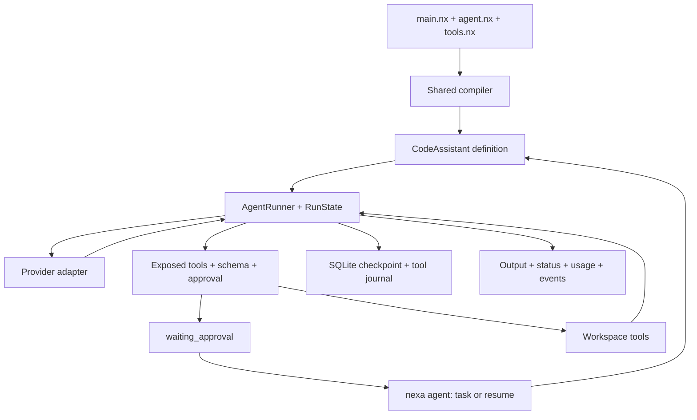

# Nexa Code — Architecture

Nexa Code declares its agent and tools in `.nx`. Python bodies in `@tool`
declarations delegate filesystem and process operations to the maintained
workspace tool module. The durable CLI compiles declarations and invokes
`CodeAssistant.execute()` with a checkpoint store.

Each fresh execution owns its messages, budgets and tool journal. Checkpoints
bind the source, agent definition, provider and working directory. A tool intent
is persisted before dispatch; its completed result is persisted before appending
the provider tool-result message. Recovery reuses completed results. Unknown
external outcomes stop execution until the operator reconciles them.

`read_file`, `search_files` and `list_directory` use bounded local reads.
`write_file` and `shell_exec` require explicit approval. File writes use a
workspace containment check and atomic replacement; commands run on the host
through the existing command policy. Approval and filesystem containment have
different responsibilities, documented in the [usage guide](usage.md).

The versioned evaluation task runs the compiled Nexa Code definition, replacing
only the model boundary with a fixture. Acceptance checks the resulting file,
verification subprocess, run status, checkpoint, approvals and call counts.
Live model quality, resource use and latency are recorded in separate evaluations.

The general runtime also supplies flow-scoped actors, parallel execution,
artifacts and native provider history. Their contracts are shared with other
Nexa applications; see [runtime v2.4](../../../docs/runtime-v2.4.md).
