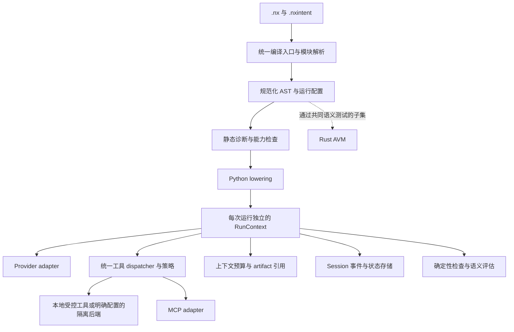

# Nexa 全面升级：以可执行的 Agent 契约为主线

状态：产品方向与 Python 优先路线已确认；2.4 本地实现和离线验收已落地。真实 provider 的质量、费用与延迟评测待配置后进行。本文保留批准时的设计与基线，当前状态和证据见 [实施记录](01-v1-execution.md)。

日期：2026-10-23（Asia/Singapore）

代码基线：`c1ec8af8e2151c293fce76da29469f24699a0c58`，版本 `2.3.1`

工作分支：`feat/nexa-runtime-modernization`

## 1. 目标与项目思想

本次目标是理解并升级整个 Nexa，使它能够适配当前模型、工具协议和长时间运行的 Agent。用户已确认以「Agent 原生语言与可靠运行时」为主线，支持人和模型编写 `.nx` 程序。本文建议以 Nexa Code 作为端到端验收应用，保留 Rust AVM 的系统研究空间。

Nexa 已有三个值得延续的核心设计：

1. **声明行为边界。** `agent` 同时描述模型、工具、上下文和输出约束，使程序结构可以被人审查，也可以被模型生成与修改。
2. **显式描述协作。** `flow`、pipeline、fork 和 context handoff 表达多个 Agent 的数据与控制关系。
3. **让意图参与验收。** `.nxintent`、IAL、`requires`、`ensures` 和 `verify` 尝试把自然语言需求连接到可执行检查。

升级后的核心承诺应当是：一个 `.nx` 程序的声明、编译诊断和执行行为一致；一次 Agent 运行能够说明使用了哪些能力、为何停止、产生了哪些结果，以及验证依据是什么。

模型在项目中承担两个角色：作为 `.nx` 程序中的执行者，以及编写、检查和修正 `.nx` 程序的作者。前者需要可靠的运行契约；后者需要精简且准确的语言文档、稳定的机器可读诊断和可执行示例。两条路径共同构成 Agent-native 的验收范围。

## 2. 已确认的现状

以下路径均相对于仓库根目录。局部复现与完整集成测试分别标注；完整测试环境的缺口见[基线记录](evidence/2026-10-23-baseline.md)。

| 领域 | 观察与证据 | 对升级的影响 |
| --- | --- | --- |
| 编译入口 | CLI 在 `src/cli.py:67` 展开一级 include，并在 `:106` 校验 Harness；SDK `src/nexa_sdk.py:246` 和 API `src/api.py:35` 分别执行另一套编译流程 | 同一程序从不同入口获得不同的依赖解析与诊断，需要统一编译服务 |
| AST 与检查 | `src/harness_validator.py:113` 的遍历混用 dict/dataclass；局部探针中顶层 autoloop 有 3 条诊断，嵌入 dataclass context 后为 0 条 | 完整 visitor 与规范化 AST 应先于更多语法扩展 |
| Harness lowering | `src/code_generator.py:2892` 生成的 autoloop 未读取退出条件；`:2932` 从错误层级读 context 参数；`:3023` 在 verify 失败后仅打印 | 必须为每个原语定义可观察行为，并通过运行结果验证 |
| 实际 Agent 路径 | `src/runtime/agent.py:518`、`:548` 直接调用 Chat Completions，`:557` 调用旧工具 dispatcher；Kernel 初始化只接入部分子系统 | 统一实际执行路径，避免独立模块各自通过测试而组合失效 |
| 状态快照 | `src/runtime/state_store.py` 使用浅拷贝；局部实测快照后修改嵌套列表，restore 得到 `[1, 2]`，预期 `[1]` | 先明确状态所有权与快照隔离，再做持久化恢复 |
| Trace 接入 | `src/runtime/harness_kernel.py:395` 调用 `.log()`，现有 TraceSystem 缺少该方法；局部实测抛 `AttributeError` | 统一事件接口，trace 成为运行路径的一部分 |
| DAG 调度 | `src/runtime/dag_orchestrator.py` 的 ForkNode 与 DAGExecutor 都执行子节点；纯函数探针中一个节点执行两次 | 有副作用工具接入前必须修正调度职责 |
| 工具边界 | `src/runtime/tool_registry.py:373` 直接在当前进程调用函数；`:382` 将声明的 sandbox 标记写入结果；`:415` 在缺少审批 manager 时自动允许 | 权限和隔离结果需要来自实际执行器；声明与执行必须闭合 |
| 缓存隔离 | `src/runtime/cache_manager.py:263` 的语义缓存按最后用户消息索引；局部实测改成法语指令和另一个 model 后仍返回旧德语结果 | 缓存键必须包含指令、模型、工具及输出契约；语义缓存应显式启用 |
| 意图验证 | `src/ial/execute.py:539` 起的语义检查会把 skipped 标记为 `passed=True`；局部探针确认否定句的关键词检查可误通过 | 结果采用 pass/fail/skip/error，并区分检查依据 |
| MCP | `src/runtime/mcp_client.py:24` 明确为 JSON schema loader；HTTP 路径读取 JSON，未实现协议会话与 `tools/call` | 用正式 SDK 接入协议，保留旧 JSON 工具目录的兼容入口 |
| Rust AVM | `avm/src/bytecode/compiler.rs:673` 生成 `CallAgent`，`avm/src/vm/interpreter.rs:151` 的 dispatch 未实现该指令；`avm/src/wasm/runtime.rs:581` 在未启用 feature 时返回模拟值 | 先公开能力矩阵，再以共同语义测试推进后端；缺失能力返回明确错误 |
| 工程基线 | 缺少项目环境、Python 现代打包配置和测试 CI；现有 workflow 只发布 site | 环境、分发与门禁作为第一个交付阶段 |

源码还包含危险工具默认关闭、文件根目录限制等已有保护。升级应将这些保护接入统一 dispatcher，逐项验证现有边界。上表描述的是具体路径的行为。

## 3. 与当前模型和 Agent 工程的关系

### 3.1 模型接口需要保留结构

当前模型交互包含工具调用、调用结果、结构化输出、流式事件、usage 和 provider 自身的状态。OpenAI 官方文档要求在相应场景保留完整 response items，以维持 reasoning 连续性；兼容性还受到模型家族影响。Nexa 应保存 provider 提供的不透明状态项，并由 adapter 负责合法重放。[OpenAI reasoning 文档](https://developers.openai.com/api/docs/guides/reasoning)

据此，建议建立小型 provider 接口，至少支持现有 OpenAI-compatible 通道，再增量接入 Responses 与 Anthropic 原生 API。每个 adapter 声明支持的能力；对于不支持的参数，在请求前返回诊断。模型名称与能力配置保持可替换，升级验收固定实际使用的 provider、model 与参数。

### 3.2 Session、模型上下文与工具环境分别管理

Anthropic 的公开架构将 session 历史、harness 和 sandbox 分为独立边界；其 context engineering 实践包含按需读取、压缩、持久笔记和子 Agent 上下文隔离。[Managed Agents 架构](https://www.anthropic.com/research/managed-agents)、[Context engineering](https://www.anthropic.com/research/effective-context-engineering-for-ai-agents)

对 Nexa 的具体建议是：保存完整 session 事件；每次模型调用根据预算构造上下文；大工具输出保存为 artifact 引用；压缩保留系统指令、任务约束、尚未完成的工具交互和关键产物。`context` 声明控制这套行为，子 Agent 使用独立的运行状态。旧的强制反思、关键词路由和模型能力打分应逐项用评测证明收益，默认执行路径保持简单。

### 3.3 工具目录连接到真实协议和授权

MCP 规范定义了 capability negotiation、分页 `tools/list`、`tools/call`、结构化结果和错误表示。接入需要覆盖这些行为，并将远端工具纳入 Nexa 的本地执行策略。[MCP tools 规范](https://modelcontextprotocol.io/specification/2025-11-25/server/tools)

### 3.4 验收以环境结果为依据

Agent 评测需要同时记录输入任务、运行轨迹与最终环境状态；多轮交互中的副作用和恢复属于验收范围。任务成功率、调用次数、token、延迟与成本要绑定同一个评测集和配置。[Anthropic Agent evals](https://www.anthropic.com/research/demystifying-evals-for-ai-agents)

Nexa 的确定性检查可以作为验收门禁；LLM judge 应返回判断、证据来源和错误状态。缺少 judge 或必要输出时返回 skip/error，由调用方决定是否允许继续。

## 4. 架构路线与取舍

| 方案 | 收益 | 代价 | 建议 |
| --- | --- | --- | --- |
| A. 保留 DSL，先贯通 Python 运行时，Rust 按语义子集推进 | 复用最完整的现有路径，较快建立端到端成果；兼容成本可分阶段承担 | 双后端需要明确能力边界和共同测试 | 推荐 |
| B. Rust AVM 作为首期主体，逐步迁入全部语言能力 | 有利于底层调度、隔离和运行时研究 | 当前 Agent opcode 与运行语义仍有缺口，首期可用成果更晚 | 用户优先选择系统研究时采用 |
| C. DSL 编译到现成 Agent 框架 | 可复用框架的执行与持久化能力 | Nexa 的状态、取消与契约语义需映射到框架，增加依赖与升级耦合 | 先做接口适配评估，再决定是否用于局部能力 |

方案 A 的执行结构：

### 4.1 首批接口

- 编译服务统一接收源码或文件、module resolver、diagnostic mode，返回生成物、source map 和 diagnostics。CLI、SDK、API 共用此服务。
- 先统一 AST normalization 与 visitor，逐步为 `AgentSpec`、`ToolSpec`、`ContextSpec`、`RunConfig` 建立强类型运行契约，保留现有 parser。
- `RunContext` 持有 run/session ID、预算、取消状态、工具集、上下文、事件与存储。Agent 定义作为配置复用；可变消息与计数属于具体 session/run。
- Provider adapter 返回结构化结果与事件。旧同步 SDK 作为适配入口；内部异步执行逐步覆盖模型、工具与并发，不在已运行的 event loop 中直接嵌套 `asyncio.run()`。
- 统一工具 dispatcher 在执行前检查暴露范围、参数、权限与剩余预算。执行结果携带成功/失败、调用 ID、可重试性、artifact 和实际隔离状态。
- Run 的活动状态为 running，可恢复暂停态为 waiting_approval；终态区分 completed、failed、cancelled、timed_out 和 budget_exhausted。审批通过后继续同一次 run，拒绝后按明确策略返回工具拒绝结果或终止运行，取消后进入终态。只有通过规定的输出检查与任务验收，才记录相应的成功状态。

### 4.2 预算、取消和重试

区分模型调用轮次、实际工具调用次数、token 用量和 wall-clock deadline。provider 支持的 usage 作为实际消耗，预估值单独记录。并行调用共享运行预算，每次 dispatch 前预留配额。

模型网络请求使用显式 timeout 和受限重试。工具按照副作用和幂等性决定是否可重试。协作式取消覆盖异步任务；需要强制终止的工具放入可终止的进程或隔离执行器，线程任务的取消边界必须在 API 中明确。

### 4.3 状态、恢复与事件

首个持久化后端采用 SQLite，先支持本地单进程运行。保存版本化 session/run、工具调用意图与完成结果、checkpoint 和 artifact 元信息。复用仓库现有存储实现中可验证的部分。

恢复到已完成工具调用时读取已保存结果。若进程在外部副作用完成后、结果落库前退出，调用状态标记为结果未知；按照工具的幂等键、状态查询或人工处理策略恢复。跨进程恢复必须纳入故障注入测试。

事件接口服务于 CLI 流式展示、trace 和 eval。默认日志只记录诊断所需元数据，敏感参数与内容按显式策略脱敏；排障输出包含 run ID、调用 ID 与错误码。

### 4.4 兼容性

保留 `.nx`、`.nxintent`、`.nxs` 的现有使用入口、CLI 命令与 Python SDK 的公共路径。无 `context` 声明的历史程序保持已有字符串交接约定。

先保留编译期 `warn/strict/off` 默认兼容行为，同时使各模式的实际语义一致。拒绝越权工具、错误参数和声明但不可用的隔离后端属于运行正确性边界，须提供准确诊断及迁移说明。IAL 四态结果、`verify` 失败行为和公共返回类型的变化采用版本化 API 或兼容适配，并用历史样例核对调用方。

HTTP、Auth、DB、KV、模板和 UI 继续作为已有能力维护；按实际导入需求拆出可选依赖。删除任何旧入口前，核对消费者并提供迁移路径。

## 5. 分阶段工作与验收

以下为批准时的阶段与验收定义。M0–M3 的本地验收、M4 的确定性应用评测及 M5 的功能子集已实现；M4 的真实模型评测仍待执行。具体完成项和运行边界见实施记录，避免将规划目标与当前能力混用。

### M0：建立可复现基线

范围：`setup.py`、`requirements.txt`、新增 `pyproject.toml` / lockfile、测试配置、`.github/workflows`、安装文档。

步骤：

1. 建立项目级 uv 环境和明确的 Python 支持矩阵，保留公共包名与 CLI 入口。
2. 核对依赖实际使用范围，区分核心、provider、UI、数据库和开发依赖；读取匹配版本的官方 API 与类型定义后锁定。
3. 验证 wheel/sdist 包含版本与运行所需资源，测试从安装后的包运行。
4. 将离线测试、真实 provider 集成测试、性能实验分组；测试使用独立临时目录与显式 fixture。
5. 增加 Python 测试、ruff/isort、ty 和 Rust 对应 feature 检查；记录现存失败并在后续阶段修复。

验收：干净环境可复现安装；离线 suite 不读取用户密钥、不调用外部模型；记录真实 collected/passed/failed/skipped；CI 的失败能够阻止相应门禁通过。Rust lockfile 与 feature 构建策略明确。

### M1：统一编译语义

范围：parser/transformer、harness validator、code generator、CLI/SDK/API、IAL；优先小型内部模块，避免同时重写语法前端。

步骤：统一模块解析与编译服务；补递归 include、循环依赖诊断、source span；让 inspect/validate/lint/harness-check 共享语义信息并提供稳定 JSON diagnostics；规范化 AST 和 visitor；编译出口验证生成 Python 的语法；建立历史语法 corpus；修正 `autoloop`、`with_context`、`verify`、snapshot 和 hook lowering 的接口。

验收：同一 fixture 从 CLI/SDK/API 得到一致的模块图与诊断；嵌套 Harness 节点无漏检；空模块和仅声明模块生成有效 Python；声明的退出条件、context 参数和失败策略有执行级回归测试。IAL skip/error 不计入成功数。

### M2：贯通单 Agent 的可靠执行路径

范围：Agent、HarnessKernel/ExecutionEngine、两套工具 registry、context、cache、trace、provider adapter；修复与该路径相关的状态和 DAG 问题。

步骤：建立每次运行的状态；让 `.nx`、SDK 和 CLI 进入同一路径；统一模型循环和工具 dispatcher；修复快照、trace、重复节点、缓存隔离；实现确定的预算终态、错误传播和取消；保留工具调用与结果的配对及 provider 必需状态；让普通、流式、Protocol 与缓存路径统一形成下游 context；先覆盖现有 compatible provider，随后验证原生 provider 事件和结构化输出。

验收：通过真实编译器与 runtime 执行 `.nx`，仅在 provider 边界使用脚本化 fake；覆盖文本、工具、结构化输出、流式工具参数拼接、错误 JSON、不可用模型能力、超时、取消、预算耗尽、越权工具及 cache/session 隔离。工具调用与结果按 ID 配对，adapter 必需状态可合法重放；历史 context pipeline fixture 通过，所有成功返回路径保持相同的 context 契约。一次已调度的普通 DAG 节点按约定执行一次。事件顺序与终态一致。

### M3：持久化、MCP 与多 Agent 生命周期

依赖：M2 的执行与事件契约稳定。

步骤：实现 SQLite checkpoint 和恢复；接入真实 MCP SDK，覆盖本地测试 server 的协商、分页、调用与关闭；统一 spawn/join/cancel 与有界并发；在并行和恢复场景延续 M2 的 context、工具消息配对与 provider 状态契约；工具输出按预算卸载。

验收：新进程能从 checkpoint 恢复；已记录的工具结果被复用；未知副作用进入明确恢复状态；MCP 断连/取消/工具错误有稳定结果；并行 Agent 状态隔离；父任务退出按策略收束子任务；压缩后消息仍满足 provider 协议。

### M4：Nexa Code 与评测闭环

依赖：M2 可交付首个本地 demo，M3 完成长期任务场景。

步骤：用现有 Nexa Code 接入统一 runtime；在隔离工作目录执行「读代码—修改—运行检查—返回证据」；完善批准、取消、恢复与失败展示；同步 README、文档、AGENT_LEARN 和对应 examples，提供经过执行验证的最小语法参考及常见诊断修复示例；建立版本化评测任务集。

验收：确定性夹具验证真实文件产物与检查结果；实际模型测试覆盖执行 `.nx` 任务及根据文档生成/修复 `.nx` 两类场景，记录模型版本、参数、预算、重复次数、任务通过率、token、延迟及成本。提升目标在取得旧版本基线后确定，保留失败轨迹与回归用例。

### M5：Rust AVM 按能力子集升级

依赖：统一语义测试和明确的性能需求。

步骤：维护 Python/Rust 能力矩阵；未实现 opcode 或未启用 WASM 返回显式错误；先实现一条完整 Agent 调用路径；共享 conformance fixtures；随后按 profiling 结果推进调度、沙盒与内存管理。

验收：所宣称子集在两个后端具有一致结果、错误与副作用；WASM feature 的实测覆盖真实执行、资源限制和失败路径；性能实验固定硬件、程序、并发与 provider 条件，分别报告本地 runtime 开销和模型请求耗时。

## 6. 首个可交付基线

M0–M2 的首个完整成果是：一个 `.nx` 程序经统一编译入口执行，调用一个显式配置的 provider，使用受允许的本地工具，返回经 schema 检查的结果；预算耗尽或工具拒绝时以明确状态退出，并产生可关联的执行记录。离线行为验收先行，真实模型连接随后验证。

这条路径稳定后，继续 M3–M5。可视化编辑器、中心化包注册表、分布式调度、新的通用语法和更多存储后端保留在后续 roadmap；引入条件是实际使用场景或测量结果。

## 7. 需要确认的决策与主要风险

已确认：产品定位为 Agent 原生语言与可靠运行时，支持人和模型编写 `.nx` 程序。

已确认：采用方案 A，优先 Python 端到端基线，再按共享语义测试演进 Rust AVM。用户明确要求按现有方案实施。

主要风险：

- 修复原先静默跳过的约束会使历史程序显式失败；迁移说明和兼容测试要覆盖这类行为变化。
- Python 异步化会影响 SDK 与 notebook/服务嵌入方式；保留同步适配并验证现有 event loop 场景。
- provider SDK 版本与现有依赖锁定差距需要实际验证；按已确认能力扩展，避免隐式丢弃字段。
- session 与工具状态涉及持久数据；schema 版本、未知副作用和 artifact 生命周期需要先于恢复功能验收。
- 完整离线测试已建立；模型质量基线待真实 provider 评测，使用固定任务、参数与预算记录结果。

## 8. 任务记录

### 2026-10-23

- 用户确认产品方向，以及 Python 优先的渐进升级路线，授权按现有方案实施。
- 完成语言/编译器、Agent runtime、工程测试及 Rust 入口的并行发现。
- 完成关键模块的局部隔离复现，确认语义接入、状态、trace、调度、缓存与工具标记问题。
- 查阅当前官方模型接口、context engineering、MCP 和 Agent eval 资料。
- 创建功能分支与本方案；进入实施阶段。
