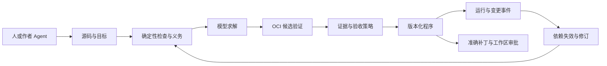

# Nexa 3.0 Open Programs：设计与实施计划

日期：2026-10-23。状态：Python 参考实现与本地验收已完成，正式发布门禁执行中，见 [发布计划](05-v1-release-3.0.0.md)。进度与设计细化见 [执行记录](04-v1-open-programs-execution.md)。

**Goal:** 让人和 Agent 共同编写可持续求解、修改和验证的 `.nx` 程序，并让编译器参与程序与语言自身的演进。

**Architecture:** 程序保存目标、实现版本、证据依赖和权限策略。模型参与编译期的实现求解与诊断，确定性内核负责类型、版本、能力和验收规则；运行时在检查点接纳经过验证的新版本。

**Tech Stack:** Python 参考实现；复用现有 provider 协议与 SQLite 持久化经验；Docker/OCI 隔离执行；Rust AVM 后续通过共同语义测试接入。具体依赖在相应任务开始前核对锁文件、官方文档和维护状态。

**Spec:** 本文第 1–9 节。已确认方向见 [2.4 发布计划](02-v1-release-2.4.0.md) 的“发布后恢复 3.0 规划”；2.4 实际行为以 [运行契约](../docs/runtime-v2.4.md) 和 [发行说明](../docs/release_notes/v2.4.0.md) 为准。

执行方式：按 `superpowers:executing-plans` 推进并完成一次整分支审查。本文件保留最初设计与发布门槛；实际接口、实现收敛、验证及剩余发布条件以 [执行记录](04-v1-open-programs-execution.md) 和 [当前使用指南](../docs/spec/3.0/usage.md) 为准。下列任务清单作为原始设计验收索引保留，不替代带环境和源码摘要的实际证据。

## 全局约束

- 稳定基线为已发布的 [v2.4.0](https://github.com/Nexa-Language/Nexa/tree/v2.4.0)，源码 `c2162637236e4a73feea410c4183672411666521`。3.0 使用独立功能分支；2.4 修复另发补丁版本。
- 已确认：Open Programs、允许破坏性升级、Python 优先、持续维护代码仓库为旗舰场景。
- 已确认：首发贯通目标求解、在线修改、证据失效和有条件的跨任务实现复用。
- 已确认：LLM/Agent 是编译环境的标准能力，人和模型使用同一套编译协作协议。
- 已确认：沙盒内自主执行，应用到用户工作区前审批；Docker/OCI 为隔离基线。
- 已确认：确定性检查、模型评审、人工确认分别记录，完成条件由显式验收策略规定。
- 已确认：语言与编译器演进使用版本化提案、语义测试和自举验证。
- 本文新增的具体语法、对象、接口、任务分界和实验阈值属于设计建议，随评审修订。

## 审查重点

1. 实现修改验收脚本或策略后，旧证据和旧授权是否失效；对应 T2、T3、T6、T8。
2. 执行器在外部副作用发生后崩溃，恢复是否重复操作；对应 T3、T5。
3. 作者、Agent 和文件系统同时产生修改，版本冲突是否被发现；对应 T4、T5、T6。
4. 复用实现的隐含依赖发生变化，是否重新验证并保留来源；对应 T2、T7。
5. 编译器修改自己的语言规则或评价标准，谁验证候选编译器；对应 T8。

## 1. 核心主张：程序具有持续履约的语义

建议将 3.0 的定位写为：**Nexa — A language for programs that stay open to change.**

程序可以先声明要达成的结果、必须遵守的边界和验收方法，再由人、模型或已有实现补齐。运行中发生目标、依赖或环境变化时，程序能够指出哪些结论失效，产生下一版实现，并在满足条件后继续工作。代码、推理过程和执行记录围绕同一个程序版本组织。

这里的 Open 有三个可观察含义：实现可以保留明确的待求解部分；已运行程序可以接纳后续修订；完成结论绑定有效条件，条件变化后重新打开相应目标。模型能力成为语言编译环境的一部分，使“编译”同时包括传统检查、实现求解和证据收集。

这要求改变开发单位：作者维护一个持续存在的程序及其义务，Agent 会话只是一次求解或修订活动。更换模型、客户端或会话后，程序仍保存哪些目标已满足、依据是什么、哪些操作获得过批准。

### 1.1 与当前进展的关系

资料核对时间为 2026-10-23。下表只描述已阅读的公开机制；Nexa 的贡献属于需要实现和实验支持的设计假设。

| 相关进展 | 已有机制 | Nexa 3.0 由此确定的研究问题 |
|---|---|---|
| [Hazel](https://hazel.org/) | 为包含 typed holes 的不完整程序提供类型与执行语义，并研究语言服务器为 LLM 补全提供静态上下文 | 如何把待求解目标扩展为带权限、验收证据和生命周期的语言对象？ |
| [DSPy 编译优化](https://dspy.ai/3.4.1/diving-deeper/choosing-an-optimizer/) 与 [Flex](https://dspy.ai/3.4.1/diving-deeper/flex/) | 编译优化根据指标生成候选；实验性的 Flex 将模块实现代码纳入搜索空间 | 候选被部署之后，如何追踪适用条件、在线修订和证据失效？ |
| [LangGraph persistence](https://docs.langchain.com/oss/python/langgraph/persistence) | checkpointer 保存线程状态，store 保存跨线程数据 | 如何给持久数据中的“实现”和“完成结论”定义可检查的复用条件？ |
| [Claude Managed Agents](https://platform.claude.com/docs/en/managed-agents/overview) | 将 Agent、Environment、Session、Events 作为持久执行的基本对象 | 程序怎样跨会话持有目标、修订关系和验收策略？ |
| [Codex app-server](https://learn.chatgpt.com/docs/app-server) | 通过结构化协议连接客户端、会话、审批和事件流 | 编译器怎样向人和作者 Agent 暴露同一套可续接的语义协作接口？ |

建议把创新假设集中为：**通过目标、修订、证据和权限的共同语义，使模型求解得到的程序能够持续演进，并把同一过程用于编译器自身。** 评估需要覆盖变化后的行为和授权完整性，而非仅统计首次生成是否通过测试。

## 2. 程序模型与最小语义

一个 Open Program 的可持久化表示由以下对象组成。对外格式显式携带 `schema_version` 和 `language_version`。

| 对象 | 必需内容 | 关键约束 |
|---|---|---|
| `ProgramRevision` | 父版本、源码与规范化 IR 摘要、目标集合、环境与策略引用 | 内容不可变；程序的当前版本引用通过 compare-and-swap 更新 |
| `GoalSpec[T]` | 稳定目标 ID、输入输出类型、求解阶段、意图、约束、允许的能力、验收策略 | 目标文本或合同变化生成新的 specification digest |
| `Candidate` | 对应目标版本、实现或补丁、来源、依赖、所需能力 | 必须通过静态检查和执行边界检查，才能进入验收 |
| `EvidenceRecord` | 证据类型、被检对象、检查器、输入与环境、结果、依赖摘要、产物引用 | 记录不可变；有效性由当前上下文计算 |
| `AcceptancePolicy` | 必需检查、模型评审规则、人工条件、失败和过期处理 | 策略本身版本化；求解器只能提交修改提案 |
| `ApprovalGrant` | 批准主体、准确对象摘要、操作范围、基线和有效期 | 应用补丁与候选验收使用不同授权对象 |

核心类型为 `Goal[T]`。它携带待求解义务；`resolve(goal)` 在当前版本满足验收策略后才产生 `Accepted[T]`。消费该结果的节点记录证据依赖。缺少实现、等待澄清或预算耗尽均有结构化状态。

显式 goal hole 可以通过部分检查：类型、允许的效果和求解阶段必须已知。无关的完整子图可以运行；依赖该目标的节点暂停。普通语法错误和类型错误仍产生诊断，作者可以通过协作接口修复。

### 2.1 状态与提交

- 目标状态：`open → solving → evaluating → satisfied`；澄清、资源或预算不足进入 `blocked(reason)`；相关依赖变化使当前满足状态变为 `stale`，再次启动求解；取消进入 `cancelled`。历史状态保留在事件中。
- 候选状态：`proposed → checked → evaluated → admitted`，失败进入 `rejected`。`admitted` 表示可被当前程序版本采用。
- 证据记录保存原始检查结果；当前有效性另算为 `valid / stale / revoked`。检查失败是结果，不能通过失效计算变为成功。
- 工作区应用状态：`awaiting_approval → approved → applying → applied`，基线变化进入 `conflict`，中断进入需要恢复确认的状态。候选被接纳与工作区应用各有独立事件。

所有状态转换由确定性内核提交。模型提交候选、解释和结构化评审结果；验收计算只读取已登记的证据和策略。多目标依赖在首发版本中使用 DAG；出现环时返回明确的循环依赖诊断。需要迭代的目标使用有预算的显式轮次。

### 2.2 对作者可见的表达

以下是 **3.0 语法草图，不能在 2.4 执行**。先确定语义，再在 T0 冻结最小语法。`repo_maintenance` 是标准策略预设，展开后仍可查看每条规则。

```text
program Maintain(repo: Repository) {
    environment developer
    sandbox repository_image
    acceptance repo_maintenance

    goal repair(change: ChangeRequest) -> Patch {
        stage runtime
        intent "根据变更请求维护仓库，并保留已有公开行为"
        context repo.snapshot
        capabilities [repo.read, sandbox.exec, sandbox.write]
        ensure checks.typecheck
        ensure checks.regression
        review model("compatibility")
        implementation open
    }

    on change_request as request {
        let result = resolve repair(request)
        propose repo.apply(result) requires human.approval
    }
}
```

自然语言表达意图；类型、能力和验收规则提供机器可检查的边界。作者可直接提供实现，或将同一位置留给模型求解。标准策略负责常用配置，避免每个 `.nx` 文件重复编写执行基础设施。

## 3. 将 LLM/Agent 融入编译环境

### 3.1 两种工作职责，一条编译链

编译链为：解析与类型检查 → 生成义务和静态上下文 → 产生候选 → 沙盒验证 → 策略接纳 → 生成版本化产物。传统编译与模型求解共享 IR、诊断和来源位置。



确定性内核负责格式、类型、效果边界、摘要、证据匹配和状态转换。模型参与目标澄清、实现生成、失败解释、方案比较和有依据的修订建议。每次求解固定内核与策略版本；需要改变规则时，另行创建提案。

编译环境提供命名能力，如 `developer.model`、`developer.author_agent`、`developer.executor`。绑定来自本地环境配置或显式项目配置，凭据通过引用取得。项目锁文件保存绑定的能力要求与可记录的模型版本，不保存密钥。现有模型配置可经适配器迁移；系统给出缺失能力诊断。

模型服务与作者 Agent 分为两类接口：前者返回模型结果，后者支持会话事件、取消、澄清和补丁提案。首发优先接入现有 provider 和一个作者客户端；兼容其他 Agent 协议按实际接口另行适配。

### 3.2 命令的效果契约

以下均为拟议 3.0 CLI，T4/T5/T6 实现时同步文档。

| 命令 | 允许行为 | 结果 |
|---|---|---|
| `nexa check file.nx` | 本地解析、类型与能力检查；零模型请求 | 诊断与未解决义务列表 |
| `nexa build file.nx` | 根据显式环境授权和预算，求解 build 阶段目标、执行隔离验证 | 程序产物、证据索引、`nexa.lock` |
| `nexa build --locked file.nx` | 校验锁定输入并复用已接纳产物；零生成请求 | 相同输入下相同规范化 IR 与实现摘要；证据过期时明确失败 |
| `nexa run file.nx` | 执行已接纳部分；按策略求解 runtime 阶段目标 | 可续接的程序实例与事件流 |
| `nexa revise <program-id>` | 接收目标或实现变更，建立候选修订 | 新版本提案及受影响证据清单 |
| `nexa explain <object-id>` | 查看来源、依赖、验收和失效原因；模型解释需显式启用 | 可追溯解释 |
| `nexa apply <proposal-id>` | 校验独立工作区授权与基线后应用准确补丁 | 应用记录或冲突 |

每个目标声明 `build` 或 `runtime` 求解阶段，默认 `build`；标准维护程序将事件触发的目标声明为 `runtime`。`build` 只允许带有这种声明的运行期目标留在产物中。模型超时、预算不足和配置缺失有稳定错误码，不启动无限重试。

`nexa.lock` 记录源码、编译器、IR、依赖、OCI 镜像、策略、候选和证据摘要，以及可复查的生成配方。可复现性分别报告“产物复用”和“重新生成”：锁定构建验证前者；重新向模型采样属于新求解活动，产生独立记录。

### 3.3 编译器与作者协作协议

首发采用带 JSON Schema 的版本化 JSON-RPC 协议，支持 stdio；网络服务留待有实际部署需求时增加。CLI、人类编辑器与 Agent 客户端调用同一接口。

- `program/check`：输入源码版本，返回诊断、目标、待解决义务及精确位置。
- `goal/resolve`：输入目标版本、环境引用和预算，返回求解活动 ID。
- `author/answer`：回答某个澄清请求，携带请求 ID 与基线版本；答案进入新的规格版本。
- `revision/propose`：提交补丁与 `expected_revision`；冲突返回最新版本及差异引用。
- `evidence/explain`：查询结果依据、有效性和依赖链。
- `activity/cancel`、`events/read`：有边界地取消，并按游标续接事件。

诊断包含 `code`、source span、期望类型/能力、相关义务、证据引用和可选修复提案。高影响歧义进入澄清状态；普通实现细节在已有合同内求解。编辑器展示具体变更与可检查产物，Agent 读取同一份结构化数据。

## 4. 证据依赖与失效传播

证据的基本有效条件为：被检对象和依赖摘要匹配，检查器及策略版本匹配，环境假设仍满足，且未过期或撤销。时间与依赖快照由可信执行侧提供。初版采用保守依赖追踪：声明依赖与执行环境共同决定范围；无法精确追踪的检查依赖整个仓库快照。

证据至少区分：`deterministic`、`model_review`、`human_decision`。模型评审保存模型身份、输入摘要、评审规则版本和结论；人工确认保存批准主体与范围；确定性证据保存实际命令、检查器、退出状态与产物引用。三者分别展示，由策略组合，避免用单一分数掩盖来源。

模型服务只能返回可变别名、无法确定具体版本时，在证据中记录这一事实。默认策略要求该类评审在新任务中重做；锁文件只对已保存产物给出身份保证。

持续维护仓库的默认策略建议为：所有必需确定性检查通过，指定模型评审通过，且证据仍有效；人工可以按明确策略处理模型评审的例外。工作区应用仍要求独立授权。测试或安全策略变更需要单独批准，新的批准不会追溯授权旧候选。

验收脚本、基线测试集合和策略在一次求解中冻结。模型提出的新测试作为补充证据；删除或改写原有验收项形成新的规格提案。可信控制器记录容器执行的检查结果，生成代码写出的“通过”文本只作为普通产物。

依赖变化后沿反向依赖传播失效，并输出最短可解释路径，例如“锁文件变化 → 环境摘要变化 → 回归证据失效 → repair 目标待重验”。历史成功记录继续可查；新版本的消费和外部提交需要当前有效的验收结果。

已发生的外部操作保留原版本与当时依据。失效会暂停依赖该证据的下一次提交，并触发修订流程；对过去操作的补偿需要单独计划和授权。

## 5. 运行中修订与隔离边界

### 5.1 在线修改的具体含义

每个运行活动绑定不可变 `ProgramRevision`。候选修订在独立沙盒中生成并验证。检查点上重新核对证据与权限，随后原子更新当前版本引用；新活动读取新版本。旧活动完成或协作取消，持续绑定原版本。

首发只在明确检查点切换，禁止替换正在执行的 Python 栈帧。状态迁移由显式、可验证的纯转换描述；不兼容状态保持阻塞并展示所需迁移。修改目标、预算、工具能力和验收规则分别产生可审查差异。

外部操作采用 intent/started/completed journal。具备幂等键的适配器可以安全重试；执行结果未知时进入 `unknown_effect`，等待适配器核对或人工解决。运行时版本切换和模型重试均遵守这个状态。

### 5.2 Docker/OCI 执行基线

执行器用固定 digest 的 OCI 镜像启动隔离环境，设置 CPU、内存、进程数和时限。源快照只读挂载，候选工作区与产物目录单独写入；容器没有宿主 Docker socket、用户主目录或默认凭据挂载。默认关闭外网；模型访问通过受控 broker，按策略限制请求与预算。额外网络能力显式授予并记录。

候选代码及其后续运行都在执行器内完成。宿主控制器只处理经过校验的 IR、协议对象和产物引用；外部工具通过 capability broker 执行。已接纳代码仍受原有能力限制，接纳事件不会授予宿主执行权限。

Linux 使用 Docker Engine；macOS 使用 Docker Desktop 或兼容 OCI VM。启动前检查当前后端是否真正实现所需限制，缺少能力返回 `executor_unavailable`。遗留 `WasmSandbox` 与宿主 `subprocess` 不能承担这一验收条件。

首发环境支持隔离执行受控项目候选；不宣称通过容器边界防御未知内核漏洞。隔离测试覆盖挂载越界、符号链接、网络策略、资源耗尽和超时清理。更强的虚拟机隔离可在共同执行器接口下单独验收。

### 5.3 应用到用户工作区

沙盒产物为 `PatchProposal`，绑定基线树摘要、受影响路径、前置文件摘要、目标内容、有效证据和权限。展示准确差异后获取 `ApprovalGrant`。应用前重新核对基线、授权、路径和文件摘要；工作区有并行修改时返回冲突。

任意目录的多文件写入采用预检、写入日志、备份与可恢复步骤。进程中断后禁止静默标记完成，恢复时核对每个文件。底层文件系统无法提供多文件原子切换，因此并发写入检测与恢复属于接口契约；Git 仓库优先以独立 checkout 生成并展示待应用补丁。

## 6. 跨任务复用与语言自演进

### 6.1 有条件的实现复用

首发把可复用成果保存为 `ImplementationCapsule`：目标模式、类型签名、实现、依赖和环境要求、效果摘要、来源与许可、原验证证据、可迁移条件。先提供显式导出/导入和本地精确索引；语义检索在正确性闭环之后增加。

命中新任务时，先检查可机器判断的条件。满足条件的实现作为新任务候选，再按当前输入和策略验证；旧证据按依赖摘要判断能否复用。无法判断的假设转化为验证义务。来源、权限或依赖冲突给出拒绝原因。

经验积累围绕可检查实现与适用条件组织。调用方可以回答“这段实现来自哪里、为什么这次适用、哪些证据重新跑过”。跨用户分发、公共市场与自动共享留到后续版本，首发默认本地存储。

### 6.2 编译器与语言自身作为 Open Program

首发交付一条受控的演进路径：`.nx` 程序分析编译诊断与失败样例，提出版本化 `EvolutionProposal`，包含源码补丁、语言/IR 版本影响、语义测试、迁移说明与预期行为。它复用同一套候选、证据、沙盒和授权机制。

固定种子编译器 `C0`、验收器 `V0` 和测试语料 `S0`。候选编译器 `C1` 在隔离环境执行语义对照、新增样例、历史回归及 bootstrap 检查。修改 `V0`、`S0` 的接纳标准或能力策略形成单独提案，由外部授权主体批准。

最小自举范围选择一个有清晰输入输出的编译 pass，例如“静态上下文到诊断建议”。用 `.nx` 表达该 pass，由 `C0` 构建后组成 `C1`；再用 `C1` 重建同一 pass 得到 `C2`，比较规范化 IR、诊断结构和锁定产物摘要。模型生成只发生在提案阶段，bootstrap 使用锁定实现。

同时演示一项小型语言扩展提案：包含 grammar/IR 版本、旧程序行为对照和迁移样例，由固定验收器验证。发布版本由人批准。首发自举指标限定于上述 pass；完整编译器自托管作为后续里程碑，保留逐步替换 Python 参考实现的路径。

## 7. 旗舰演示：一个程序持续维护一个仓库

演示使用一个固定、小型、有完整离线测试的 Python 仓库，并把所有输入变化作为可回放事件保存。

1. **首次求解。** 人写 `maintain.nx` 的目标和合同，作者 Agent 接入编译协议。编译器发现一个验收歧义并请求澄清，回答进入规格版本。模型在 OCI 沙盒产生补丁，测试与模型评审形成独立证据。
2. **应用前审批。** 展示补丁、基线和证据，获得授权后应用到测试工作区。保留程序 ID 与版本历史，重启进程后继续。
3. **目标发生变化。** 人在同一程序中更新需求。旧活动绑定原版本，新修订显示证据失效路径；更新实现、重验并在检查点切换。
4. **依赖发生变化。** 更新固定依赖或测试环境。系统指出需要重验的目标，并保留无关、仍有效的证据。
5. **第二个任务复用。** 从第一个任务导出实现 capsule，在条件相符的任务中验证复用；在条件不符的任务中拒绝或补齐验证义务。
6. **编译器自身改进。** 根据本次诊断缺口生成一个编译 pass 改进提案，通过固定语料、bootstrap 和授权后选择新编译器版本。

故障脚本在这些阶段插入进程重启、模型不可用、预算耗尽、工作区并行修改及工具结果未知。演示报告同时展示成功路径和明确的阻塞状态。

## 8. 与 2.4 的工程关系

| 现有代码 | 3.0 处理方式 |
|---|---|
| `src/compiler.py`、`src/nexa_parser.py`、`src/ast_transformer.py`、`src/code_generator.py` | 保留规范编译入口；新增显式版本路由。3.0 使用独立 frontend 与规范化 IR，按能力接入已有语法，避免在旧 AST 的隐式属性上继续叠加状态 |
| `src/runtime/providers.py`、`src/runtime/native_providers.py` | 复用模型请求/响应边界，新增编译预算与来源记录；真实 provider 单独集成验收 |
| `src/runtime/agent_runner.py` | 作为受限求解活动的适配基础；程序生命周期由新的控制器负责 |
| `src/runtime/run_state.py`、`src/runtime/checkpoints.py` | 复用 journal、SQLite 和版本冲突经验；3.0 持久化使用独立 schema 和命名空间 |
| `src/runtime/artifacts.py` | 复用内容寻址产物机制，新增来源、证据与保留规则 |
| `src/runtime/workspace_tools.py`、`src/runtime/tool_dispatch.py` | 现有工具通过能力适配器接入；宿主工作区写入进入独立应用服务 |
| `src/runtime/wasm_sandbox.py` | 保留 2.4 支持范围，3.0 新建 OCI 执行器并独立验证隔离契约 |
| `src/agent_cli.py` | 接入统一编译协作协议；Nexa Code、文档与编辑器消费版本化 schema |
| `tests/test_conformance.py`、`tests/fixtures/conformance/programs.json` | 保留历史 corpus，新增 3.0 共同语义与状态转换 corpus，为后续 Rust 实现提供依据 |

2.4 状态库只读导出，转换生成新的 3.0 数据库与迁移报告。语言入口显式选择 2.x/3.x 模式，默认由项目版本决定；遇到未知状态或协议版本直接诊断。迁移优先保留 `.nx` 的基本计算、工具和 provider 用法，逐项列明已支持映射和需要人工处理的结构。

标准库、Nexa Code、文档站与编辑器在核心 schema 冻结后适配。首发 Python 对外版本底线沿用 2.4 的 Python 3.10，并在 3.10/3.12/3.14 CI 验证；如果新增依赖要求提高版本，提交具体兼容性决策。Rust 完整 Agent 执行能力不作为首发依赖。

## 9. 评价方法与发布门槛

### 9.1 可验证的不变量

以下发布要求的实测结果见 [本地验收](evidence/2026-10-23-open-programs-validation.md)；托管 CI、正式包与官网门禁由 [3.0 发布计划](05-v1-release-3.0.0.md) 追踪。

- 所有强制语义、故障恢复与授权用例通过；遗漏必需证据时，候选接纳率为 0。
- 发布验收语料中，失效证据被当作有效证据使用的次数为 0；未授权宿主写入与重复不可幂等操作次数为 0。
- 锁定构建在相同工具链与输入条件下，规范化 IR、候选实现和依赖摘要一致；模型生成请求数为 0。
- 旗舰演示六个阶段可以从已保存快照重放，并提供完整来源链；有意注入的故障按预期阻塞或恢复。
- Linux/macOS 两类 OCI 环境通过执行器契约；公开发行包从新环境安装后完成离线检查、锁定运行与沙盒 smoke。

### 9.2 模型效果实验

建立版本化 manifest，固定任务仓库 SHA、变更事件、可见上下文、验收脚本、隔离镜像、模型标识、工具权限和预算。对照组包括 2.4 harness 实现和 3.0；涉及外部系统的比较先验证其可实现同等任务与授权约束。

建议首轮使用至少 10 个可公开回放的维护任务，每个任务包含初始修复、需求变化和依赖变化三个阶段，每个模型设置重复 3 次。该规模用于发现问题与估计方差；公开声明泛化收益前再扩充独立任务集。

分别报告任务验收率、错误接纳率、人工介入次数、完成时延分布、模型 token/费用、重验工作量、复用命中与拒绝原因。费用使用当次调用记录和明确价格基准。成本更低、速度更快属于待验证假设，首发可靠性门槛独立检查。

消融实验关闭证据依赖追踪、关闭跨任务复用、改用非协作式编译输入，观察变化后的失败率、重复工作和人工干预。冻结验收集合，求解器只看到允许的训练与反馈内容，另留保留任务评估泛化。

## 10. 文件边界与公共接口

以下路径均为拟新建，除非标明“现有”。先按模块责任落地，达到实际复杂度后再拆包。

| 路径 | 责任 |
|---|---|
| `src/open_programs/model.py` | 类型化数据对象、版本与枚举；统一 ID/digest 别名和错误类型 |
| `src/open_programs/frontend.py` | 3.0 语法、类型/能力检查、规范化 IR、源码位置 |
| `src/open_programs/evidence.py` | 证据有效性、反向依赖失效、策略判定 |
| `src/open_programs/store.py` | SQLite 事务、版本 CAS、事件游标、恢复 |
| `src/open_programs/executor.py` | OCI 生命周期、模型 broker、资源限制、可信检查结果 |
| `src/open_programs/compiler.py` | 目标求解、预算、候选接纳、锁定构建 |
| `src/open_programs/protocol.py` | 作者协作协议、schema、事件与取消 |
| `src/open_programs/controller.py` | 目标调度、检查点切换、状态迁移和副作用状态 |
| `src/open_programs/workspace.py` | 补丁提案、工作区授权、应用与中断恢复 |
| `src/open_programs/reuse.py` | capsule 导入/导出、条件匹配与验证义务 |
| `src/open_programs/evolution.py` | 编译器提案、固定验收器与 bootstrap 驱动 |
| `src/open_programs/cli.py` | 拟议命令，供现有 CLI 入口分派 |
| `docs/spec/3.0/`、`schemas/3.0/` | 版本化语义、协议与格式；只保存对外需要的 schema |
| `tests/open_programs/`、`tests/fixtures/open_programs/` | 语义、故障、隔离与端到端 fixture |
| `examples/open_programs/`、`benchmarks/open_programs/` | 旗舰示例、任务 manifest 与评估驱动 |

接口中的数据类型统一在 `model.py` 定义；下列签名表达任务间的契约，异常统一包含稳定错误码、相关对象 ID 和可重试条件。外部协议对这些类型生成 JSON Schema。

## 11. 按依赖推进的实施任务

各任务先固定行为测试，再实现并验证；涉及 Python 的改动执行仓库 Ruff、isort、ty 检查。任务完成后按已获授权范围提交和审查。首条可演示闭环由 T0–T4 组成，随后逐项加入连续演进能力。

任务中的短模块名均位于 `src/open_programs/`，短测试名均位于 `tests/open_programs/`。下表为拟议文件落地后的定向命令；通过条件包含对应任务列出的行为断言。OCI、真实 provider 和完整故障用例分别分组记录，缺失环境使用明确 skip reason，发布门禁需要的环境不得以跳过代替通过。

| 任务 | 定向验证命令 |
|---|---|
| T0 | `uv run pytest tests/open_programs/test_semantics.py -q` |
| T1 | `uv run pytest tests/open_programs/test_frontend.py tests/test_conformance.py -q` |
| T2 | `uv run pytest tests/open_programs/test_evidence.py tests/open_programs/test_store.py -q` |
| T3 | `uv run pytest tests/open_programs/test_executor.py -q` |
| T4 | `uv run pytest tests/open_programs/test_compilation.py tests/open_programs/test_author_protocol.py -q` |
| T5 | `uv run pytest tests/open_programs/test_revision_runtime.py tests/open_programs/test_recovery.py -q` |
| T6 | `uv run pytest tests/open_programs/test_workspace_apply.py -q` |
| T7 | `uv run pytest tests/open_programs/test_reuse.py -q` |
| T8 | `uv run pytest tests/open_programs/test_evolution.py -q` |
| T9 | `uv run pytest -m "not benchmark"`，以及单独记录的第 9.2 节模型实验 |

新增 Python 模块执行 `uv run ruff check src/open_programs tests/open_programs`、`uv run isort --check-only src/open_programs tests/open_programs` 和 `uv run ty check src/open_programs`。新增模块纳入现有 `.github/workflows/ci.yml` 的维护清单；受影响的现有文件沿用已有检查范围。

### T0：冻结最小语言语义与验收语料

**依赖：** 本设计评审。**文件：** 新建 `docs/spec/3.0/core.md`、`schemas/3.0/program.schema.json`、`src/open_programs/model.py`、`tests/fixtures/open_programs/semantics.json`。

**产出接口：** 第 2 节六类对象；`GoalState`、`CandidateState`、`EvidenceValidity`；后续所用 `SourceBundle`、`ProgramIR`、`ContextSnapshot`、`BuildArtifact`、`ResolutionBudget`、`PatchProposal`、`ImplementationCapsule`、`EvolutionProposal` 等值对象及其引用关系。精简仅被单一模块使用的内部对象，禁止循环 schema 引用。

- [ ] 固定 `.nx` 最小语法、build/runtime 阶段、类型/能力规则、目标与版本状态转换；为每个转换提供正例和拒绝例。
- [ ] 将第 7 节事件脚本转为固定 fixture，定义预期状态、证据依赖、授权边界和产物摘要规则。
- [ ] 编写 schema/fixture 一致性测试 `tests/open_programs/test_semantics.py`；验收所有状态具有明确触发条件，未知版本和循环目标依赖有稳定诊断。

### T1：可离线检查的 Open Program 编译前端

**依赖：** T0。**文件：** 新建 `frontend.py`、`cli.py`、`tests/open_programs/test_frontend.py`；修改现有 `src/compiler.py` 的显式版本分派和 `src/cli.py` 入口。

**接口：** `check(source: SourceBundle) -> CheckReport`；`CheckReport` 包含 `ProgramIR`、诊断与未解决义务。类型与约束由 T0 定义。

- [ ] 为显式 hole、普通类型错误、越权能力、未解析引用、循环目标依赖和 2.x 版本分派建立行为测试。
- [ ] 实现可序列化规范化 IR、source span 与确定性摘要；`check` 不创建 provider。
- [ ] 运行前端测试及现有编译入口相关回归；相同源码检查输出稳定，model transport spy 的调用计数为 0。

### T2：证据有效性、验收策略与持久化

**依赖：** T0、T1。**文件：** 新建 `evidence.py`、`store.py`、`tests/open_programs/test_evidence.py`、`test_store.py`；参考现有 `src/runtime/checkpoints.py`，保持其 2.4 schema 独立。

**接口：** `validate_evidence(record: EvidenceRecord, context: ContextSnapshot) -> EvidenceStatus`；`evaluate_policy(policy: AcceptancePolicy, records: list[EvidenceRecord], context: ContextSnapshot) -> AdmissionDecision`；`commit_revision(expected: RevisionId, revision: ProgramRevision, events: list[ProgramEvent]) -> RevisionId`。

- [ ] 测试源码、测试脚本、环境、模型评审规则、人工授权和有效期变化的失效传播；同内容无关变化按声明依赖保留证据。
- [ ] 实现不可变记录、内容引用、反向依赖和 SQLite CAS；策略输出完整的缺失/失败/过期原因。
- [ ] 注入提交前后进程退出、重复事件、双写者冲突和未知 schema；验收重启后状态一致，失败检查无法被旧成功记录覆盖。

### T3：OCI 候选执行与可信验证

**依赖：** T0、T2。**文件：** 新建 `executor.py`、`tests/open_programs/test_executor.py`、`tests/fixtures/open_programs/oci/`、`docs/spec/3.0/executor.md`。

**接口：** `execute_candidate(candidate: Candidate, spec: ExecutionSpec) -> ExecutionReport`；`ExecutionSpec` 固定镜像、能力、输入、冻结检查器与资源限制；报告由控制器采集并转换为证据。

- [ ] 用测试镜像复现挂载越界、符号链接、外网访问、伪造结果文本、超时和资源耗尽；设置具名 fixture，避免操作宿主真实工作区。
- [ ] 实现执行器、受控模型 broker、产物收集和取消清理；provider 与数据库凭据保留在宿主控制器侧。
- [ ] Linux 和 macOS 后端运行同一契约；缺少隔离能力时明确失败。验证工具副作用 intent 与执行结果关联，结果未知时保留待处理状态。

### T4：模型参与编译与作者协作

**依赖：** T1–T3。**文件：** 新建 `compiler.py`、`protocol.py`、`schemas/3.0/author-protocol.schema.json`、`test_compilation.py`、`test_author_protocol.py`；扩展 `cli.py`，适配现有 provider 接口。

**接口：** `resolve_goal(goal: GoalSpec, context: ContextSnapshot, budget: ResolutionBudget) -> ResolutionResult`；`build(program: ProgramIR, environment: EnvironmentBinding, mode: BuildMode) -> BuildArtifact`；第 3.3 节协议方法。

- [ ] 用 scripted provider 测试一次目标求解、澄清后续接、预算耗尽、模型中断、错误候选和双作者冲突；诊断必须指向源码与具体义务。
- [ ] 实现候选生成→隔离检查→证据登记→策略接纳；结构化记录模型与工具费用、失败原因和取消边界。
- [ ] 实现锁文件和 `--locked`；同输入产物摘要相同，锁定路径零生成请求，缺失产物或过期证据给出明确修复路径。
- [ ] 完成一个人类 CLI 客户端与一个 Agent 协议客户端的同程序协作演示；真实 provider 集成记录端点/模型版本及实际结果，凭据不进入产物。

**阶段交付：** 作者可以写有明确待求解部分的 `.nx`，编译器通过模型补齐并在沙盒验证，生成可锁定重放的程序产物。

### T5：持续运行、修订与故障恢复

**依赖：** T2–T4。**文件：** 新建 `controller.py`、`tests/open_programs/test_revision_runtime.py`、`test_recovery.py`；扩展 `cli.py` 与协议事件 schema。

**接口：** `propose_revision(base: RevisionId, change: RevisionChange) -> RevisionProposal`；`activate_revision(proposal: RevisionProposal, checkpoint: CheckpointId) -> ActivationResult`；`resume(program_id: ProgramId) -> ProgramStatus`。

- [ ] 测试运行中修改目标、实现与依赖，要求旧活动保持原版本、失效路径准确、新活动读取通过验收的新版本。
- [ ] 实现安全检查点、纯状态迁移、CAS 切换、协作取消和待决外部操作处理。
- [ ] 在工具执行前后、证据登记前后、版本切换前后注入崩溃；断言可幂等操作按键恢复，未知不可幂等结果保持阻塞，不重复调用。

### T6：工作区审批与可靠应用

**依赖：** T2、T3、T5。**文件：** 新建 `workspace.py`、`tests/open_programs/test_workspace_apply.py`；修改 `src/agent_cli.py` 的 3.0 路径，扩展 `cli.py`。

**接口：** `prepare_patch(base: WorkspaceSnapshot, candidate: Candidate) -> PatchProposal`；`apply_patch(proposal: PatchProposal, grant: ApprovalGrant) -> ApplyResult`。

- [ ] 测试批准后补丁变化、工作区变化、授权过期、路径越界、符号链接替换和重复应用；所有越权情况在对应写入前拒绝。
- [ ] 实现准确 diff、批准绑定、预检、应用日志及中断恢复；多文件应用中途退出后可定位已写与未写文件。
- [ ] 在临时 Git 仓库和普通目录验收；未批准宿主写入计数为 0，冲突保留用户变更，审计事件可解释实际应用结果。

### T7：有条件的跨任务实现复用

**依赖：** T2、T4、T5。**文件：** 新建 `reuse.py`、`schemas/3.0/capsule.schema.json`、`tests/open_programs/test_reuse.py`。

**接口：** `export_capsule(candidate: Candidate, evidence: list[EvidenceRecord]) -> ImplementationCapsule`；`match_capsule(capsule: ImplementationCapsule, goal: GoalSpec, context: ContextSnapshot) -> ReuseDecision`。

- [ ] 建立相符、类型不符、依赖漂移、能力超界、来源不明和条件无法判断的复用 fixture。
- [ ] 实现显式导入/导出、本地匹配和验证义务生成；复用进入普通候选接纳路径。
- [ ] 验收同条件复用、异条件拒绝与增量重验；报告复用证据和重验清单，全部对象保留原始来源。

### T8：受控的编译器演进与局部自举

**依赖：** T4–T7。**文件：** 新建 `evolution.py`、`examples/open_programs/compiler_pass.nx`、`tests/open_programs/test_evolution.py`、`docs/spec/3.0/evolution.md`。

**接口：** `evaluate_evolution(proposal: EvolutionProposal, seed: CompilerIdentity, suite: SemanticSuite) -> EvolutionReport`；输出包含固定验收器结果与 `C0 → C1 → C2` 的产物比较。

- [ ] 选择一个静态上下文到诊断建议 pass，冻结输入输出、种子工具链和语料；补充会被旧 pass 触发的真实失败 fixture。
- [ ] 通过 `.nx` 演进程序生成候选 pass，验证局部 bootstrap；另交付一个带版本与迁移测试的小型语言扩展提案。
- [ ] 测试候选修改评价标准、降低检查等级、提升自身权限、依赖未锁定及自举不一致；固定验收器拒绝越权修改，授权只作用于准确候选。

### T9：完整演示、迁移、生态适配与 3.0 发布候选

**依赖：** T0–T8。**文件：** 新建 `examples/open_programs/maintain.nx`、`benchmarks/open_programs/manifest.json`、`tests/open_programs/test_maintenance_e2e.py`、`docs/migration/2.4-to-3.0.md`、`docs/release_notes/v3.0.0.md`；更新现有 CI、打包与官网；生态仓库按独立授权和接口版本适配。

**接口：** 冻结的语言版本、协议 schema、迁移报告格式和 `BuildArtifact`；Rust 消费同一语义 corpus。

- [ ] 运行第 7 节全部演示与故障脚本，保存版本、证据、授权和环境对应关系；完成第 9 节对照与消融实验。
- [ ] 验证 2.4 状态只读导出、3.0 转换及错误报告；更新双语文档、Nexa Code 和编辑器的目标/证据/修订界面。
- [ ] Python 3.10/3.12/3.14 CI、OCI 双平台契约、干净发行物安装、锁定运行通过后形成 3.0 RC；真实服务未覆盖项明确记录。
- [ ] 评审演示和研究结果，再执行独立发布计划；RC 阶段只修复已识别问题，避免扩大语言范围。

## 12. 关键取舍与执行顺序

| 选择 | 当前建议 | 收益与代价 |
|---|---|---|
| 编译器参与程度 | 原生支持模型求解和协作协议，保留零模型检查与锁定构建 | 人与模型共享语义上下文；需清楚记录费用和非确定性边界 |
| 在线修改 | 检查点接纳不可变修订 | 恢复、审查和证据匹配可控；切换时机受活动长度影响 |
| 证据粒度 | 先保守依赖，再用观察数据细化 | 优先避免漏失效；初期部分检查会重复执行 |
| 复用机制 | 本地 capsule 与显式条件，后续加入语义检索 | 可先证明适用性；初期召回率受索引限制 |
| 自演进 | 首发包含真实局部自举和语言提案，逐步推进完整自托管 | 早期展示语言参与改进自身；固定种子与独立验收需长期维护 |
| 实现节奏 | T0–T4 端到端编译闭环，T5–T7 持续演进，T8 自举，T9 发布候选 | 每阶段都有可运行产物；版本号 3.0 的验收保留完整主线 |

优先评审最小语言表达和目标/证据/权限三者的契约，然后开始 T0。发布范围保持围绕一条持续维护仓库的完整链路；分布式多租户平台、公共实现市场、全栈帧热替换和完整编译器自托管分别进入后续路线图。

## 13. 本计划的自检记录

- 用户确认的七项方向已分别对应 T0–T9；首发四项能力分别落在 T4、T5、T2、T7。
- 编译器协作落在 T4，工作区审批落在 T6，语言/编译器演进落在 T8；第 7 节作为统一验收入口。
- 2.4 已有模块与拟新建模块分开列明；所有 3.0 命令、语法、接口和阈值标为设计提案。
- 证据有效性、目标生命周期、候选接纳和工作区授权具有独立定义；执行未知结果与模型失败分开处理。
- 规划阶段只修改文档；后续已完成 Python 参考实现、真实模型演示、两轮矩阵和本地验收。历史规划建议与实际交付边界在执行记录中分别保存。
